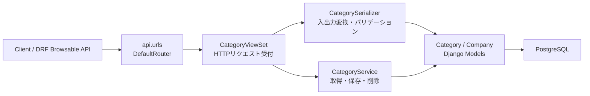
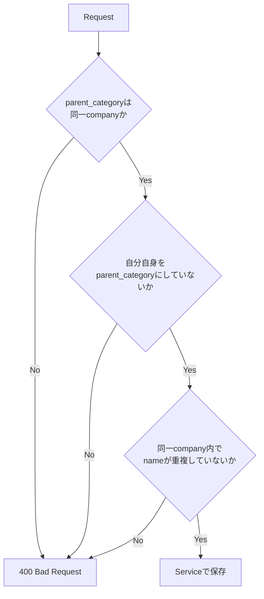

# coding-interview

## Category API

CategoryモデルのCRUD APIをDjango REST frameworkで実装しています。
認証は考慮せず、Categoryの読み取り・作成・更新・削除をAPIから操作できます。

## 構成



## エンドポイント

| Method | Path | 処理 |
| --- | --- | --- |
| GET | `/api/categories/` | カテゴリ一覧取得 |
| POST | `/api/categories/` | カテゴリ作成 |
| GET | `/api/categories/{id}/` | カテゴリ詳細取得 |
| PUT | `/api/categories/{id}/` | カテゴリ全体更新 |
| PATCH | `/api/categories/{id}/` | カテゴリ部分更新 |
| DELETE | `/api/categories/{id}/` | カテゴリ削除 |

## バリデーション



| 観点 | 内容 |
| --- | --- |
| CRUD | list / retrieve / create / update / destroy |
| 重複制約 | 同一company内の同名カテゴリを拒否 |
| 企業境界 | 別companyであれば同名カテゴリを許可 |
| 親子関係 | 別companyのカテゴリを親にすることを拒否 |
| 循環防止 | 自分自身を親カテゴリにすることを拒否 |

## Docker実行

Docker ComposeでDjangoとPostgreSQLをまとめて起動します。

```powershell
docker compose up --build
```

API:

```text
http://localhost:8000/api/categories/
```

テスト:

```powershell
docker compose exec web python manage.py test
```

停止:

```powershell
docker compose down
```

## PostgreSQL設定

Docker実行時の既定値は以下です。

| 項目 | 値 |
| --- | --- |
| database | `coding-test` |
| user | `root` |
| password | `password` |
| app port | `8000` |

接続情報を変更したい場合は、`.env.example` を参考に `.env` を作成してください。
Docker内のDjangoはPostgreSQLへ `db:5432` で接続します。

## Docker設計書

Docker構成の詳細は `docs/docker-design.md` に記載しています。
