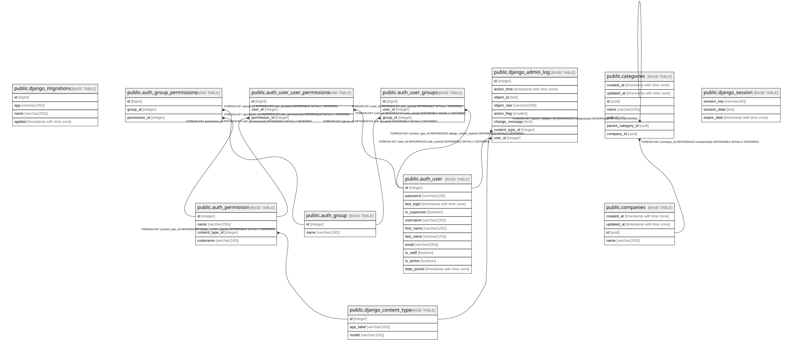

# interview_db

## Tables

| Name | Columns | Comment | Type |
| ---- | ------- | ------- | ---- |
| [public.django_migrations](public.django_migrations.md) | 4 |  | BASE TABLE |
| [public.django_content_type](public.django_content_type.md) | 3 |  | BASE TABLE |
| [public.auth_permission](public.auth_permission.md) | 4 |  | BASE TABLE |
| [public.auth_group](public.auth_group.md) | 2 |  | BASE TABLE |
| [public.auth_group_permissions](public.auth_group_permissions.md) | 3 |  | BASE TABLE |
| [public.auth_user](public.auth_user.md) | 11 |  | BASE TABLE |
| [public.auth_user_groups](public.auth_user_groups.md) | 3 |  | BASE TABLE |
| [public.auth_user_user_permissions](public.auth_user_user_permissions.md) | 3 |  | BASE TABLE |
| [public.django_admin_log](public.django_admin_log.md) | 8 |  | BASE TABLE |
| [public.companies](public.companies.md) | 4 | 企業テーブル | BASE TABLE |
| [public.categories](public.categories.md) | 7 | カテゴリテーブル | BASE TABLE |
| [public.django_session](public.django_session.md) | 3 |  | BASE TABLE |

## Stored procedures and functions

| Name | ReturnType | Arguments | Type |
| ---- | ------- | ------- | ---- |
| public.ltree_in | ltree | cstring | FUNCTION |
| public.ltree_out | cstring | ltree | FUNCTION |
| public.ltree_cmp | int4 | ltree, ltree | FUNCTION |
| public.ltree_lt | bool | ltree, ltree | FUNCTION |
| public.ltree_le | bool | ltree, ltree | FUNCTION |
| public.ltree_eq | bool | ltree, ltree | FUNCTION |
| public.ltree_ge | bool | ltree, ltree | FUNCTION |
| public.ltree_gt | bool | ltree, ltree | FUNCTION |
| public.ltree_ne | bool | ltree, ltree | FUNCTION |
| public.subltree | ltree | ltree, integer, integer | FUNCTION |
| public.subpath | ltree | ltree, integer, integer | FUNCTION |
| public.subpath | ltree | ltree, integer | FUNCTION |
| public.index | int4 | ltree, ltree | FUNCTION |
| public.index | int4 | ltree, ltree, integer | FUNCTION |
| public.nlevel | int4 | ltree | FUNCTION |
| public.ltree2text | text | ltree | FUNCTION |
| public.text2ltree | ltree | text | FUNCTION |
| public.lca | ltree | ltree[] | FUNCTION |
| public.lca | ltree | ltree, ltree | FUNCTION |
| public.lca | ltree | ltree, ltree, ltree | FUNCTION |
| public.lca | ltree | ltree, ltree, ltree, ltree | FUNCTION |
| public.lca | ltree | ltree, ltree, ltree, ltree, ltree | FUNCTION |
| public.lca | ltree | ltree, ltree, ltree, ltree, ltree, ltree | FUNCTION |
| public.lca | ltree | ltree, ltree, ltree, ltree, ltree, ltree, ltree | FUNCTION |
| public.lca | ltree | ltree, ltree, ltree, ltree, ltree, ltree, ltree, ltree | FUNCTION |
| public.ltree_isparent | bool | ltree, ltree | FUNCTION |
| public.ltree_risparent | bool | ltree, ltree | FUNCTION |
| public.ltree_addltree | ltree | ltree, ltree | FUNCTION |
| public.ltree_addtext | ltree | ltree, text | FUNCTION |
| public.ltree_textadd | ltree | text, ltree | FUNCTION |
| public.ltreeparentsel | float8 | internal, oid, internal, integer | FUNCTION |
| public.lquery_in | lquery | cstring | FUNCTION |
| public.lquery_out | cstring | lquery | FUNCTION |
| public.ltq_regex | bool | ltree, lquery | FUNCTION |
| public.ltq_rregex | bool | lquery, ltree | FUNCTION |
| public.lt_q_regex | bool | ltree, lquery[] | FUNCTION |
| public.lt_q_rregex | bool | lquery[], ltree | FUNCTION |
| public.ltxtq_in | ltxtquery | cstring | FUNCTION |
| public.ltxtq_out | cstring | ltxtquery | FUNCTION |
| public.ltxtq_exec | bool | ltree, ltxtquery | FUNCTION |
| public.ltxtq_rexec | bool | ltxtquery, ltree | FUNCTION |
| public.ltree_gist_in | ltree_gist | cstring | FUNCTION |
| public.ltree_gist_out | cstring | ltree_gist | FUNCTION |
| public.ltree_consistent | bool | internal, ltree, smallint, oid, internal | FUNCTION |
| public.ltree_compress | internal | internal | FUNCTION |
| public.ltree_decompress | internal | internal | FUNCTION |
| public.ltree_penalty | internal | internal, internal, internal | FUNCTION |
| public.ltree_picksplit | internal | internal, internal | FUNCTION |
| public.ltree_union | ltree_gist | internal, internal | FUNCTION |
| public.ltree_same | internal | ltree_gist, ltree_gist, internal | FUNCTION |
| public._ltree_isparent | bool | ltree[], ltree | FUNCTION |
| public._ltree_r_isparent | bool | ltree, ltree[] | FUNCTION |
| public._ltree_risparent | bool | ltree[], ltree | FUNCTION |
| public._ltree_r_risparent | bool | ltree, ltree[] | FUNCTION |
| public._ltq_regex | bool | ltree[], lquery | FUNCTION |
| public._ltq_rregex | bool | lquery, ltree[] | FUNCTION |
| public._lt_q_regex | bool | ltree[], lquery[] | FUNCTION |
| public._lt_q_rregex | bool | lquery[], ltree[] | FUNCTION |
| public._ltxtq_exec | bool | ltree[], ltxtquery | FUNCTION |
| public._ltxtq_rexec | bool | ltxtquery, ltree[] | FUNCTION |
| public._ltree_extract_isparent | ltree | ltree[], ltree | FUNCTION |
| public._ltree_extract_risparent | ltree | ltree[], ltree | FUNCTION |
| public._ltq_extract_regex | ltree | ltree[], lquery | FUNCTION |
| public._ltxtq_extract_exec | ltree | ltree[], ltxtquery | FUNCTION |
| public._ltree_consistent | bool | internal, ltree[], smallint, oid, internal | FUNCTION |
| public._ltree_compress | internal | internal | FUNCTION |
| public._ltree_penalty | internal | internal, internal, internal | FUNCTION |
| public._ltree_picksplit | internal | internal, internal | FUNCTION |
| public._ltree_union | ltree_gist | internal, internal | FUNCTION |
| public._ltree_same | internal | ltree_gist, ltree_gist, internal | FUNCTION |
| public.ltree_recv | ltree | internal | FUNCTION |
| public.ltree_send | bytea | ltree | FUNCTION |
| public.lquery_recv | lquery | internal | FUNCTION |
| public.lquery_send | bytea | lquery | FUNCTION |
| public.ltxtq_recv | ltxtquery | internal | FUNCTION |
| public.ltxtq_send | bytea | ltxtquery | FUNCTION |
| public.ltree_gist_options | void | internal | FUNCTION |
| public._ltree_gist_options | void | internal | FUNCTION |
| public.hash_ltree | int4 | ltree | FUNCTION |
| public.hash_ltree_extended | int8 | ltree, bigint | FUNCTION |

## Relations

---

> Generated by [tbls](https://github.com/k1LoW/tbls)
