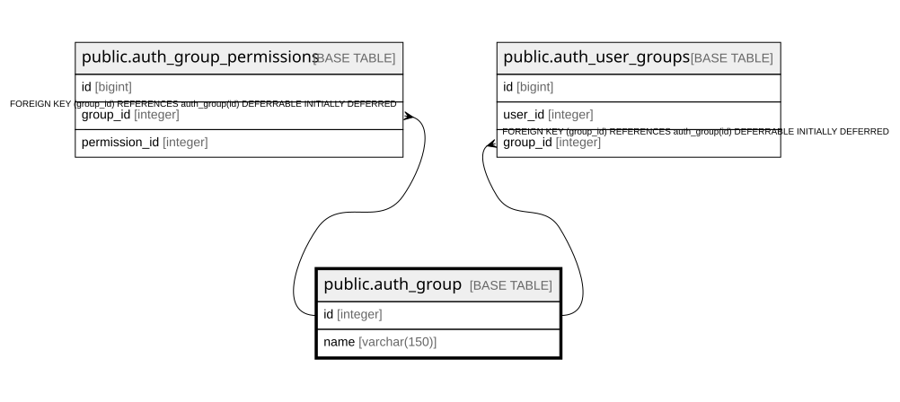

# public.auth_group

## Description

## Columns

| Name | Type | Default | Nullable | Children | Parents | Comment |
| ---- | ---- | ------- | -------- | -------- | ------- | ------- |
| id | integer |  | false | [public.auth_group_permissions](public.auth_group_permissions.md) [public.auth_user_groups](public.auth_user_groups.md) |  |  |
| name | varchar(150) |  | false |  |  |  |

## Constraints

| Name | Type | Definition |
| ---- | ---- | ---------- |
| auth_group_pkey | PRIMARY KEY | PRIMARY KEY (id) |
| auth_group_name_key | UNIQUE | UNIQUE (name) |

## Indexes

| Name | Definition |
| ---- | ---------- |
| auth_group_pkey | CREATE UNIQUE INDEX auth_group_pkey ON public.auth_group USING btree (id) |
| auth_group_name_key | CREATE UNIQUE INDEX auth_group_name_key ON public.auth_group USING btree (name) |
| auth_group_name_a6ea08ec_like | CREATE INDEX auth_group_name_a6ea08ec_like ON public.auth_group USING btree (name varchar_pattern_ops) |

## Relations

---

> Generated by [tbls](https://github.com/k1LoW/tbls)
