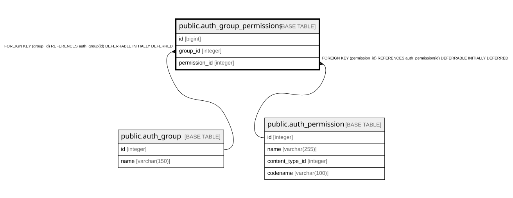

# public.auth_group_permissions

## Description

## Columns

| Name | Type | Default | Nullable | Children | Parents | Comment |
| ---- | ---- | ------- | -------- | -------- | ------- | ------- |
| id | bigint |  | false |  |  |  |
| group_id | integer |  | false |  | [public.auth_group](public.auth_group.md) |  |
| permission_id | integer |  | false |  | [public.auth_permission](public.auth_permission.md) |  |

## Constraints

| Name | Type | Definition |
| ---- | ---- | ---------- |
| auth_group_permissio_permission_id_84c5c92e_fk_auth_perm | FOREIGN KEY | FOREIGN KEY (permission_id) REFERENCES auth_permission(id) DEFERRABLE INITIALLY DEFERRED |
| auth_group_permissions_group_id_b120cbf9_fk_auth_group_id | FOREIGN KEY | FOREIGN KEY (group_id) REFERENCES auth_group(id) DEFERRABLE INITIALLY DEFERRED |
| auth_group_permissions_pkey | PRIMARY KEY | PRIMARY KEY (id) |
| auth_group_permissions_group_id_permission_id_0cd325b0_uniq | UNIQUE | UNIQUE (group_id, permission_id) |

## Indexes

| Name | Definition |
| ---- | ---------- |
| auth_group_permissions_pkey | CREATE UNIQUE INDEX auth_group_permissions_pkey ON public.auth_group_permissions USING btree (id) |
| auth_group_permissions_group_id_permission_id_0cd325b0_uniq | CREATE UNIQUE INDEX auth_group_permissions_group_id_permission_id_0cd325b0_uniq ON public.auth_group_permissions USING btree (group_id, permission_id) |
| auth_group_permissions_group_id_b120cbf9 | CREATE INDEX auth_group_permissions_group_id_b120cbf9 ON public.auth_group_permissions USING btree (group_id) |
| auth_group_permissions_permission_id_84c5c92e | CREATE INDEX auth_group_permissions_permission_id_84c5c92e ON public.auth_group_permissions USING btree (permission_id) |

## Relations

---

> Generated by [tbls](https://github.com/k1LoW/tbls)
