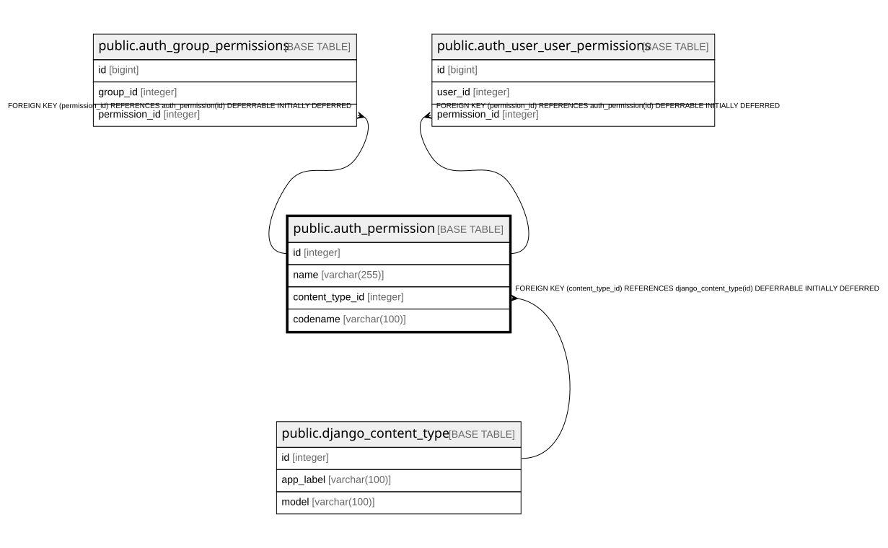

# public.auth_permission

## Description

## Columns

| Name | Type | Default | Nullable | Children | Parents | Comment |
| ---- | ---- | ------- | -------- | -------- | ------- | ------- |
| id | integer |  | false | [public.auth_group_permissions](public.auth_group_permissions.md) [public.auth_user_user_permissions](public.auth_user_user_permissions.md) |  |  |
| name | varchar(255) |  | false |  |  |  |
| content_type_id | integer |  | false |  | [public.django_content_type](public.django_content_type.md) |  |
| codename | varchar(100) |  | false |  |  |  |

## Constraints

| Name | Type | Definition |
| ---- | ---- | ---------- |
| auth_permission_content_type_id_2f476e4b_fk_django_co | FOREIGN KEY | FOREIGN KEY (content_type_id) REFERENCES django_content_type(id) DEFERRABLE INITIALLY DEFERRED |
| auth_permission_pkey | PRIMARY KEY | PRIMARY KEY (id) |
| auth_permission_content_type_id_codename_01ab375a_uniq | UNIQUE | UNIQUE (content_type_id, codename) |

## Indexes

| Name | Definition |
| ---- | ---------- |
| auth_permission_pkey | CREATE UNIQUE INDEX auth_permission_pkey ON public.auth_permission USING btree (id) |
| auth_permission_content_type_id_codename_01ab375a_uniq | CREATE UNIQUE INDEX auth_permission_content_type_id_codename_01ab375a_uniq ON public.auth_permission USING btree (content_type_id, codename) |
| auth_permission_content_type_id_2f476e4b | CREATE INDEX auth_permission_content_type_id_2f476e4b ON public.auth_permission USING btree (content_type_id) |

## Relations

---

> Generated by [tbls](https://github.com/k1LoW/tbls)
