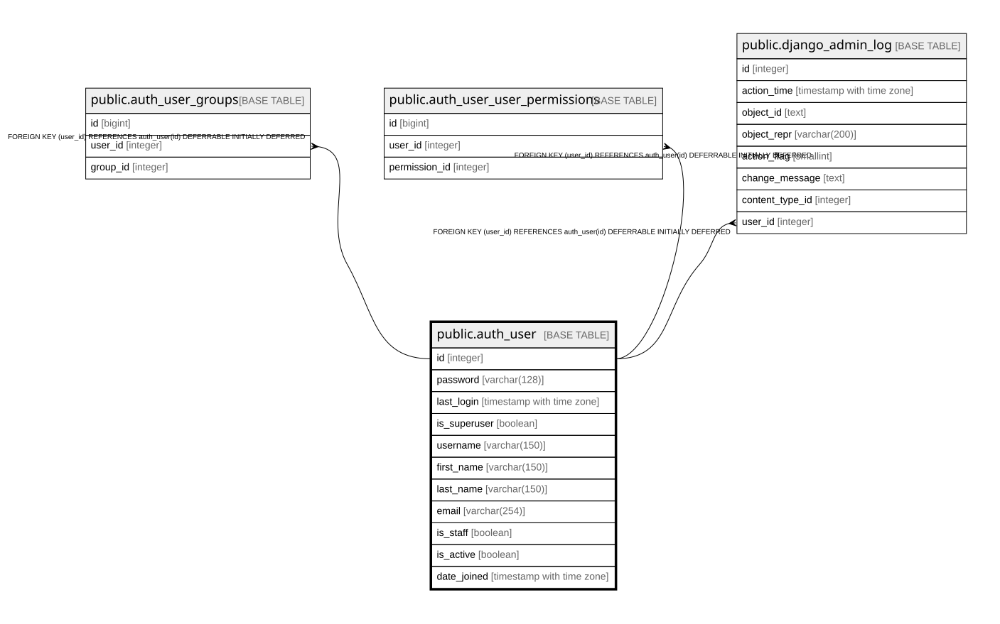

# public.auth_user

## Description

## Columns

| Name | Type | Default | Nullable | Children | Parents | Comment |
| ---- | ---- | ------- | -------- | -------- | ------- | ------- |
| id | integer |  | false | [public.auth_user_groups](public.auth_user_groups.md) [public.auth_user_user_permissions](public.auth_user_user_permissions.md) [public.django_admin_log](public.django_admin_log.md) |  |  |
| password | varchar(128) |  | false |  |  |  |
| last_login | timestamp with time zone |  | true |  |  |  |
| is_superuser | boolean |  | false |  |  |  |
| username | varchar(150) |  | false |  |  |  |
| first_name | varchar(150) |  | false |  |  |  |
| last_name | varchar(150) |  | false |  |  |  |
| email | varchar(254) |  | false |  |  |  |
| is_staff | boolean |  | false |  |  |  |
| is_active | boolean |  | false |  |  |  |
| date_joined | timestamp with time zone |  | false |  |  |  |

## Constraints

| Name | Type | Definition |
| ---- | ---- | ---------- |
| auth_user_pkey | PRIMARY KEY | PRIMARY KEY (id) |
| auth_user_username_key | UNIQUE | UNIQUE (username) |

## Indexes

| Name | Definition |
| ---- | ---------- |
| auth_user_pkey | CREATE UNIQUE INDEX auth_user_pkey ON public.auth_user USING btree (id) |
| auth_user_username_key | CREATE UNIQUE INDEX auth_user_username_key ON public.auth_user USING btree (username) |
| auth_user_username_6821ab7c_like | CREATE INDEX auth_user_username_6821ab7c_like ON public.auth_user USING btree (username varchar_pattern_ops) |

## Relations

---

> Generated by [tbls](https://github.com/k1LoW/tbls)
