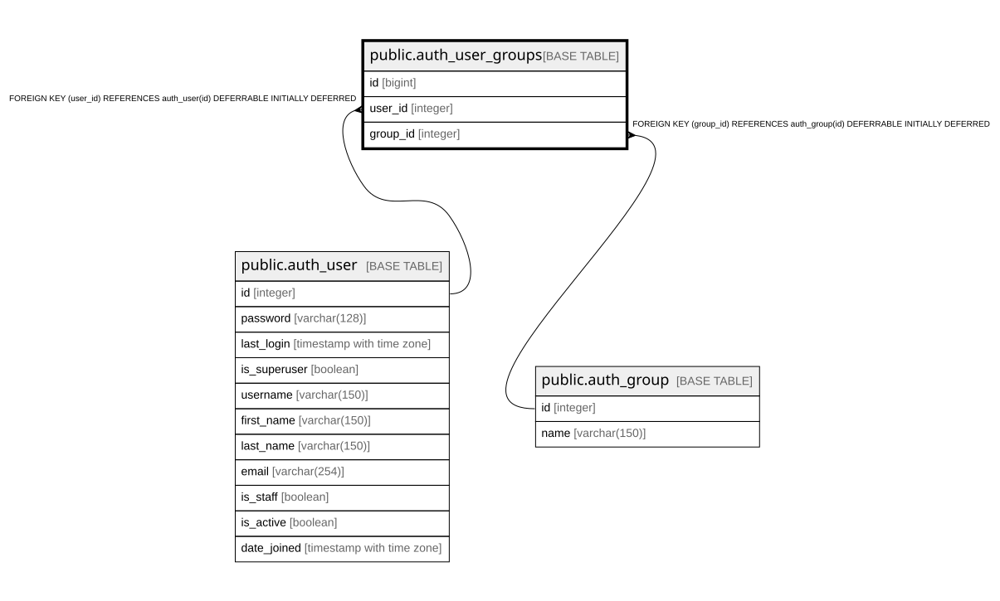

# public.auth_user_groups

## Description

## Columns

| Name | Type | Default | Nullable | Children | Parents | Comment |
| ---- | ---- | ------- | -------- | -------- | ------- | ------- |
| id | bigint |  | false |  |  |  |
| user_id | integer |  | false |  | [public.auth_user](public.auth_user.md) |  |
| group_id | integer |  | false |  | [public.auth_group](public.auth_group.md) |  |

## Constraints

| Name | Type | Definition |
| ---- | ---- | ---------- |
| auth_user_groups_group_id_97559544_fk_auth_group_id | FOREIGN KEY | FOREIGN KEY (group_id) REFERENCES auth_group(id) DEFERRABLE INITIALLY DEFERRED |
| auth_user_groups_user_id_6a12ed8b_fk_auth_user_id | FOREIGN KEY | FOREIGN KEY (user_id) REFERENCES auth_user(id) DEFERRABLE INITIALLY DEFERRED |
| auth_user_groups_pkey | PRIMARY KEY | PRIMARY KEY (id) |
| auth_user_groups_user_id_group_id_94350c0c_uniq | UNIQUE | UNIQUE (user_id, group_id) |

## Indexes

| Name | Definition |
| ---- | ---------- |
| auth_user_groups_pkey | CREATE UNIQUE INDEX auth_user_groups_pkey ON public.auth_user_groups USING btree (id) |
| auth_user_groups_user_id_group_id_94350c0c_uniq | CREATE UNIQUE INDEX auth_user_groups_user_id_group_id_94350c0c_uniq ON public.auth_user_groups USING btree (user_id, group_id) |
| auth_user_groups_user_id_6a12ed8b | CREATE INDEX auth_user_groups_user_id_6a12ed8b ON public.auth_user_groups USING btree (user_id) |
| auth_user_groups_group_id_97559544 | CREATE INDEX auth_user_groups_group_id_97559544 ON public.auth_user_groups USING btree (group_id) |

## Relations

---

> Generated by [tbls](https://github.com/k1LoW/tbls)
