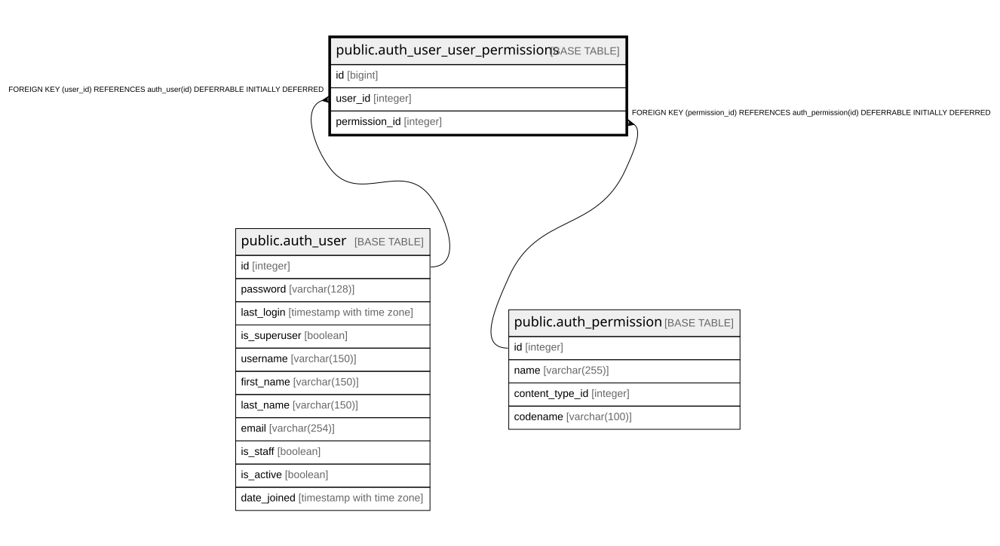

# public.auth_user_user_permissions

## Description

## Columns

| Name | Type | Default | Nullable | Children | Parents | Comment |
| ---- | ---- | ------- | -------- | -------- | ------- | ------- |
| id | bigint |  | false |  |  |  |
| user_id | integer |  | false |  | [public.auth_user](public.auth_user.md) |  |
| permission_id | integer |  | false |  | [public.auth_permission](public.auth_permission.md) |  |

## Constraints

| Name | Type | Definition |
| ---- | ---- | ---------- |
| auth_user_user_permi_permission_id_1fbb5f2c_fk_auth_perm | FOREIGN KEY | FOREIGN KEY (permission_id) REFERENCES auth_permission(id) DEFERRABLE INITIALLY DEFERRED |
| auth_user_user_permissions_user_id_a95ead1b_fk_auth_user_id | FOREIGN KEY | FOREIGN KEY (user_id) REFERENCES auth_user(id) DEFERRABLE INITIALLY DEFERRED |
| auth_user_user_permissions_pkey | PRIMARY KEY | PRIMARY KEY (id) |
| auth_user_user_permissions_user_id_permission_id_14a6b632_uniq | UNIQUE | UNIQUE (user_id, permission_id) |

## Indexes

| Name | Definition |
| ---- | ---------- |
| auth_user_user_permissions_pkey | CREATE UNIQUE INDEX auth_user_user_permissions_pkey ON public.auth_user_user_permissions USING btree (id) |
| auth_user_user_permissions_user_id_permission_id_14a6b632_uniq | CREATE UNIQUE INDEX auth_user_user_permissions_user_id_permission_id_14a6b632_uniq ON public.auth_user_user_permissions USING btree (user_id, permission_id) |
| auth_user_user_permissions_user_id_a95ead1b | CREATE INDEX auth_user_user_permissions_user_id_a95ead1b ON public.auth_user_user_permissions USING btree (user_id) |
| auth_user_user_permissions_permission_id_1fbb5f2c | CREATE INDEX auth_user_user_permissions_permission_id_1fbb5f2c ON public.auth_user_user_permissions USING btree (permission_id) |

## Relations

---

> Generated by [tbls](https://github.com/k1LoW/tbls)
