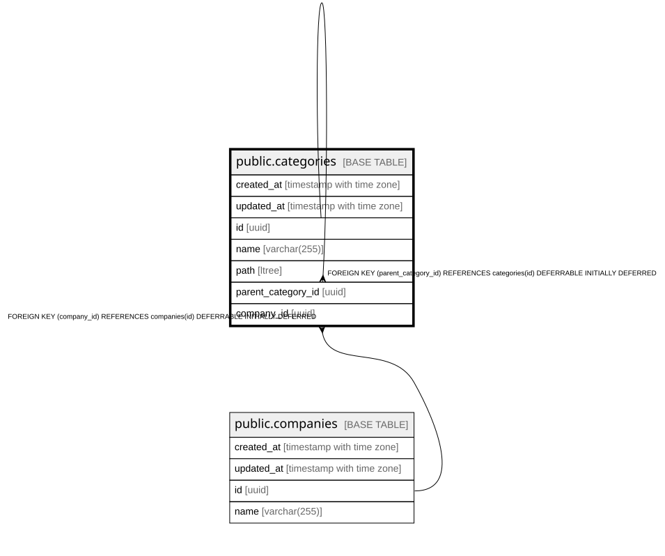

# public.categories

## Description

カテゴリテーブル

## Columns

| Name | Type | Default | Nullable | Children | Parents | Comment |
| ---- | ---- | ------- | -------- | -------- | ------- | ------- |
| created_at | timestamp with time zone |  | false |  |  | 作成日時 |
| updated_at | timestamp with time zone |  | false |  |  | 更新日時 |
| id | uuid |  | false | [public.categories](public.categories.md) |  |  |
| name | varchar(255) |  | false |  |  | カテゴリ名 |
| path | ltree |  | false |  |  | マテリアライズドパスを使用したltree型 |
| parent_category_id | uuid |  | true |  | [public.categories](public.categories.md) | 親カテゴリID |
| company_id | uuid |  | false |  | [public.companies](public.companies.md) | 企業ID |

## Constraints

| Name | Type | Definition |
| ---- | ---- | ---------- |
| prevent_self_parent | CHECK | CHECK ((NOT ((parent_category_id = id) AND (parent_category_id IS NOT NULL)))) |
| categories_company_id_a54db8fb_fk_companies_id | FOREIGN KEY | FOREIGN KEY (company_id) REFERENCES companies(id) DEFERRABLE INITIALLY DEFERRED |
| categories_parent_category_id_a0ce61fa_fk_categories_id | FOREIGN KEY | FOREIGN KEY (parent_category_id) REFERENCES categories(id) DEFERRABLE INITIALLY DEFERRED |
| categories_pkey | PRIMARY KEY | PRIMARY KEY (id) |
| unique_company_category_combination | UNIQUE | UNIQUE (company_id, name) |

## Indexes

| Name | Definition |
| ---- | ---------- |
| categories_pkey | CREATE UNIQUE INDEX categories_pkey ON public.categories USING btree (id) |
| unique_company_category_combination | CREATE UNIQUE INDEX unique_company_category_combination ON public.categories USING btree (company_id, name) |
| categories_path_9eb797b5 | CREATE INDEX categories_path_9eb797b5 ON public.categories USING btree (path) |
| categories_parent_category_id_a0ce61fa | CREATE INDEX categories_parent_category_id_a0ce61fa ON public.categories USING btree (parent_category_id) |
| categories_company_id_a54db8fb | CREATE INDEX categories_company_id_a54db8fb ON public.categories USING btree (company_id) |
| categories_company_18f426_idx | CREATE INDEX categories_company_18f426_idx ON public.categories USING btree (company_id, name) |
| categories_path_eecba4_idx | CREATE INDEX categories_path_eecba4_idx ON public.categories USING btree (path) |

## Relations

---

> Generated by [tbls](https://github.com/k1LoW/tbls)
