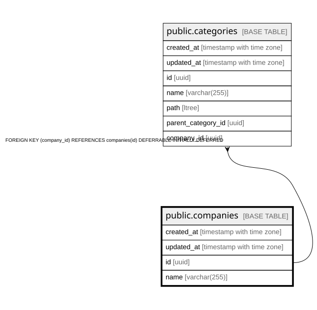

# public.companies

## Description

企業テーブル

## Columns

| Name | Type | Default | Nullable | Children | Parents | Comment |
| ---- | ---- | ------- | -------- | -------- | ------- | ------- |
| created_at | timestamp with time zone |  | false |  |  | 作成日時 |
| updated_at | timestamp with time zone |  | false |  |  | 更新日時 |
| id | uuid |  | false | [public.categories](public.categories.md) |  | 企業ID |
| name | varchar(255) |  | false |  |  | 企業名 |

## Constraints

| Name | Type | Definition |
| ---- | ---- | ---------- |
| companies_pkey | PRIMARY KEY | PRIMARY KEY (id) |

## Indexes

| Name | Definition |
| ---- | ---------- |
| companies_pkey | CREATE UNIQUE INDEX companies_pkey ON public.companies USING btree (id) |

## Relations

---

> Generated by [tbls](https://github.com/k1LoW/tbls)
