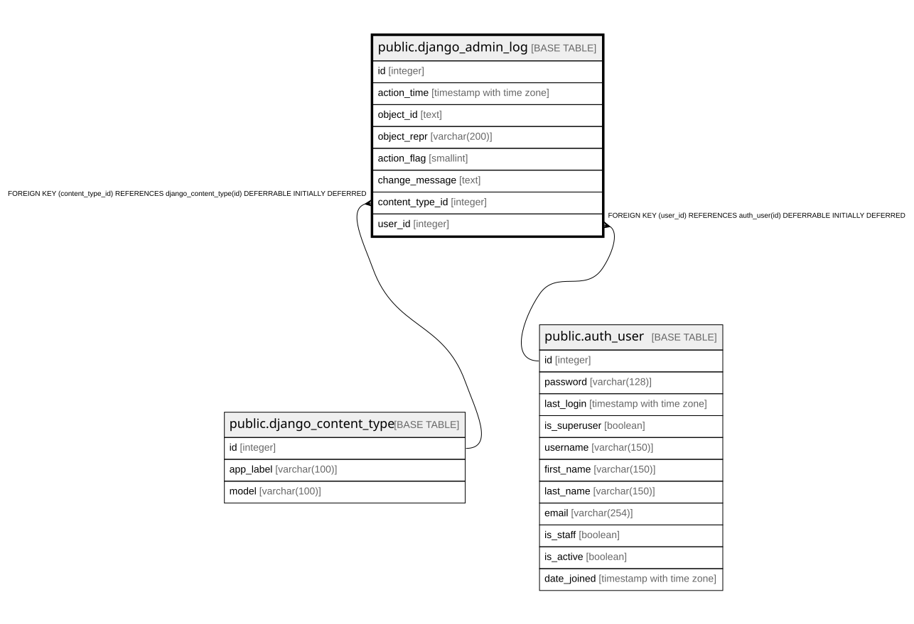

# public.django_admin_log

## Description

## Columns

| Name | Type | Default | Nullable | Children | Parents | Comment |
| ---- | ---- | ------- | -------- | -------- | ------- | ------- |
| id | integer |  | false |  |  |  |
| action_time | timestamp with time zone |  | false |  |  |  |
| object_id | text |  | true |  |  |  |
| object_repr | varchar(200) |  | false |  |  |  |
| action_flag | smallint |  | false |  |  |  |
| change_message | text |  | false |  |  |  |
| content_type_id | integer |  | true |  | [public.django_content_type](public.django_content_type.md) |  |
| user_id | integer |  | false |  | [public.auth_user](public.auth_user.md) |  |

## Constraints

| Name | Type | Definition |
| ---- | ---- | ---------- |
| django_admin_log_action_flag_check | CHECK | CHECK ((action_flag >= 0)) |
| django_admin_log_content_type_id_c4bce8eb_fk_django_co | FOREIGN KEY | FOREIGN KEY (content_type_id) REFERENCES django_content_type(id) DEFERRABLE INITIALLY DEFERRED |
| django_admin_log_user_id_c564eba6_fk_auth_user_id | FOREIGN KEY | FOREIGN KEY (user_id) REFERENCES auth_user(id) DEFERRABLE INITIALLY DEFERRED |
| django_admin_log_pkey | PRIMARY KEY | PRIMARY KEY (id) |

## Indexes

| Name | Definition |
| ---- | ---------- |
| django_admin_log_pkey | CREATE UNIQUE INDEX django_admin_log_pkey ON public.django_admin_log USING btree (id) |
| django_admin_log_content_type_id_c4bce8eb | CREATE INDEX django_admin_log_content_type_id_c4bce8eb ON public.django_admin_log USING btree (content_type_id) |
| django_admin_log_user_id_c564eba6 | CREATE INDEX django_admin_log_user_id_c564eba6 ON public.django_admin_log USING btree (user_id) |

## Relations

---

> Generated by [tbls](https://github.com/k1LoW/tbls)
