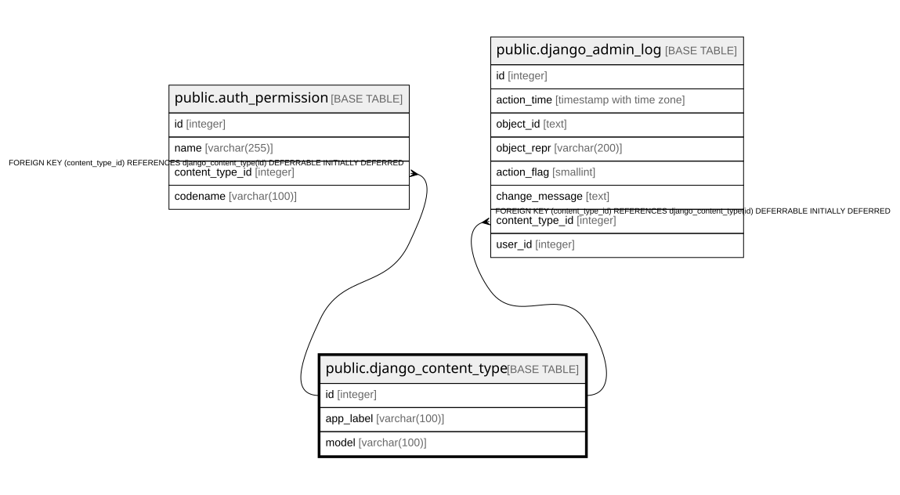

# public.django_content_type

## Description

## Columns

| Name | Type | Default | Nullable | Children | Parents | Comment |
| ---- | ---- | ------- | -------- | -------- | ------- | ------- |
| id | integer |  | false | [public.auth_permission](public.auth_permission.md) [public.django_admin_log](public.django_admin_log.md) |  |  |
| app_label | varchar(100) |  | false |  |  |  |
| model | varchar(100) |  | false |  |  |  |

## Constraints

| Name | Type | Definition |
| ---- | ---- | ---------- |
| django_content_type_pkey | PRIMARY KEY | PRIMARY KEY (id) |
| django_content_type_app_label_model_76bd3d3b_uniq | UNIQUE | UNIQUE (app_label, model) |

## Indexes

| Name | Definition |
| ---- | ---------- |
| django_content_type_pkey | CREATE UNIQUE INDEX django_content_type_pkey ON public.django_content_type USING btree (id) |
| django_content_type_app_label_model_76bd3d3b_uniq | CREATE UNIQUE INDEX django_content_type_app_label_model_76bd3d3b_uniq ON public.django_content_type USING btree (app_label, model) |

## Relations

---

> Generated by [tbls](https://github.com/k1LoW/tbls)
