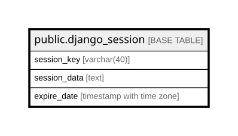

# public.django_session

## Description

## Columns

| Name | Type | Default | Nullable | Children | Parents | Comment |
| ---- | ---- | ------- | -------- | -------- | ------- | ------- |
| session_key | varchar(40) |  | false |  |  |  |
| session_data | text |  | false |  |  |  |
| expire_date | timestamp with time zone |  | false |  |  |  |

## Constraints

| Name | Type | Definition |
| ---- | ---- | ---------- |
| django_session_pkey | PRIMARY KEY | PRIMARY KEY (session_key) |

## Indexes

| Name | Definition |
| ---- | ---------- |
| django_session_pkey | CREATE UNIQUE INDEX django_session_pkey ON public.django_session USING btree (session_key) |
| django_session_session_key_c0390e0f_like | CREATE INDEX django_session_session_key_c0390e0f_like ON public.django_session USING btree (session_key varchar_pattern_ops) |
| django_session_expire_date_a5c62663 | CREATE INDEX django_session_expire_date_a5c62663 ON public.django_session USING btree (expire_date) |

## Relations

---

> Generated by [tbls](https://github.com/k1LoW/tbls)
