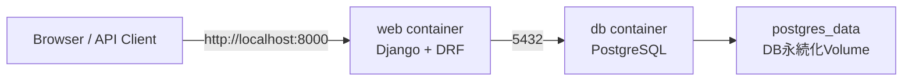
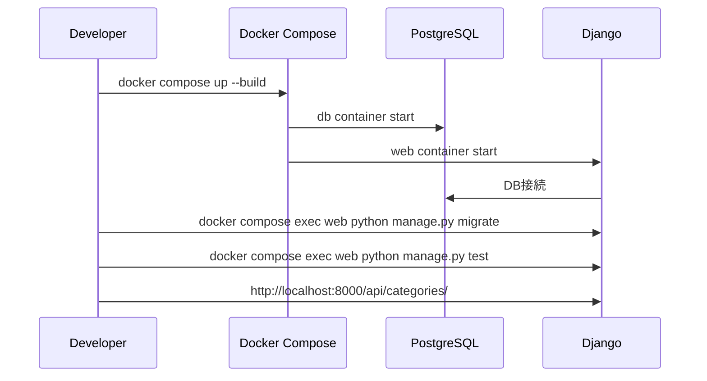

# Docker設計書

## 目的

Category CRUD APIを、ローカル環境差分に依存せず起動・検証できるようにする。
DjangoアプリケーションとPostgreSQLをDocker Composeで管理し、以下を再現可能にする。

- APIサーバー起動
- PostgreSQL起動
- マイグレーション実行
- APIテスト実行

## 前提

| 項目 | 内容 |
| --- | --- |
| Python | 3.11 |
| Framework | Django 4.2.4 / Django REST framework 3.14.0 |
| DB | PostgreSQL |
| 依存管理 | Pipfile / Pipfile.lock |
| アプリ起動ポート | 8000 |

## 全体構成



## コンテナ構成

### web

Djangoアプリケーションを起動するコンテナ。

主な責務:

- Python依存関係のインストール
- Djangoアプリケーションの起動
- `manage.py migrate` の実行
- `manage.py test` の実行

想定設定:

| 設定 | 値 |
| --- | --- |
| build context | `.` |
| working dir | `/app` |
| command | `python manage.py runserver 0.0.0.0:8000` |
| ports | `8000:8000` |
| depends_on | `db` |

### db

PostgreSQLを起動するコンテナ。

想定設定:

| 設定 | 値 |
| --- | --- |
| image | `postgres:15` |
| database | `coding-test` |
| user | `root` |
| password | `password` |
| volume | `postgres_data:/var/lib/postgresql/data` |

## 環境変数

Djangoの `settings.py` はすでに環境変数からDB接続情報を読む構成になっているため、Dockerでも同じ変数を使う。

| 環境変数 | 用途 | Dockerでの例 |
| --- | --- | --- |
| `POSTGRES_DB` | DB名 | `coding-test` |
| `POSTGRES_USER` | DBユーザー | `root` |
| `POSTGRES_PASSWORD` | DBパスワード | `password` |
| `DB_HOST_NAME` | DBホスト | `db` |
| `DB_PORT` | DBポート | `5432` |

ローカル実行では `DB_HOST_NAME=localhost`、Docker Compose内では `DB_HOST_NAME=db` になる点に注意する。
Docker Compose内のDjangoはPostgreSQLへ直接 `db:5432` で接続する。

## 起動フロー



## 追加ファイル

以下のファイルでDocker起動を実装する。

```text
Dockerfile
docker-compose.yml
.dockerignore
.env.example
```

### Dockerfile案

```dockerfile
FROM python:3.11-slim

ENV PYTHONDONTWRITEBYTECODE=1
ENV PYTHONUNBUFFERED=1

WORKDIR /app

RUN apt-get update \
    && apt-get install -y --no-install-recommends gcc libc6-dev libpq-dev \
    && rm -rf /var/lib/apt/lists/*

COPY Pipfile Pipfile.lock /app/
RUN pip install --no-cache-dir pipenv \
    && pipenv install --deploy --system

COPY . /app/

EXPOSE 8000

CMD ["python", "manage.py", "runserver", "0.0.0.0:8000"]
```

### docker-compose.yml案

```yaml
services:
  web:
    build: .
    command: python manage.py runserver 0.0.0.0:8000
    volumes:
      - .:/app
    ports:
      - "8000:8000"
    environment:
      POSTGRES_DB: coding-test
      POSTGRES_USER: root
      POSTGRES_PASSWORD: password
      DB_HOST_NAME: db
      DB_PORT: 5432
    depends_on:
      - db

  db:
    image: postgres:15
    environment:
      POSTGRES_DB: coding-test
      POSTGRES_USER: root
      POSTGRES_PASSWORD: password
    volumes:
      - postgres_data:/var/lib/postgresql/data

volumes:
  postgres_data:
```

### .dockerignore案

```text
.git
.venv
__pycache__
*.pyc
db.sqlite3
server*.log
```

## 操作コマンド

```bash
docker compose up --build
```

別ターミナルで:

```bash
docker compose exec web python manage.py migrate
docker compose exec web python manage.py test
```

API確認:

```text
http://localhost:8000/api/categories/
```

## 補足

開発用途では `volumes: - .:/app` を使い、ホスト側のコード変更を即時反映する。
本番用途ではソースコードをイメージ内に固定し、`runserver` ではなくGunicornなどのWSGIサーバーを利用する。
